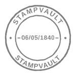
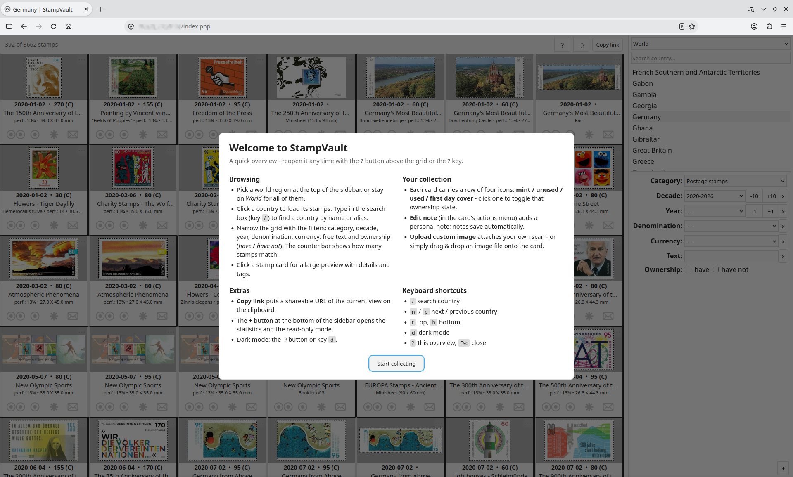
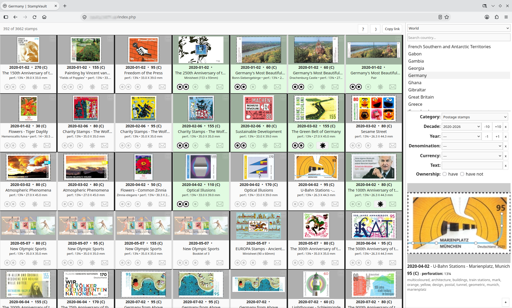
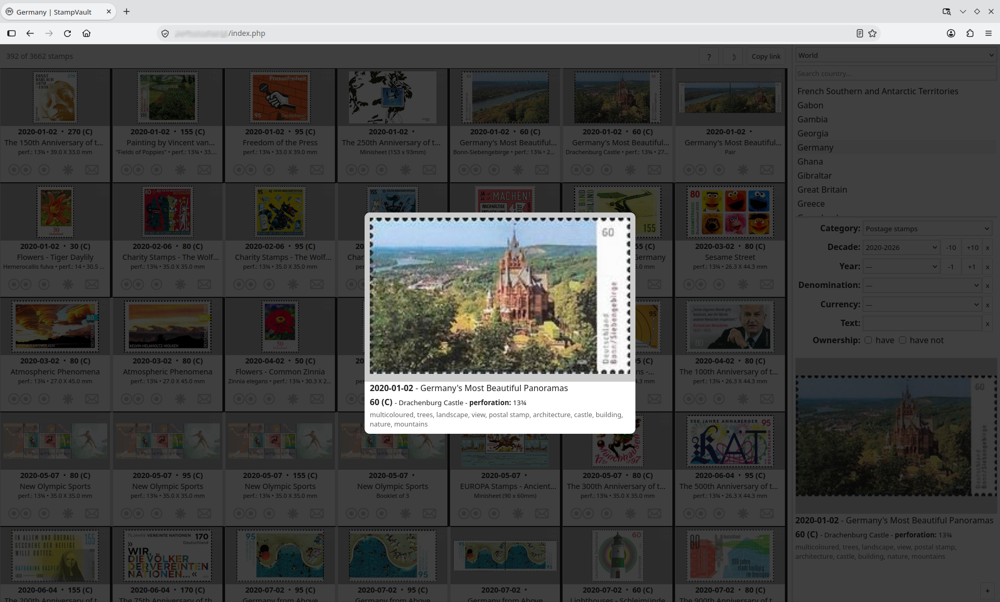
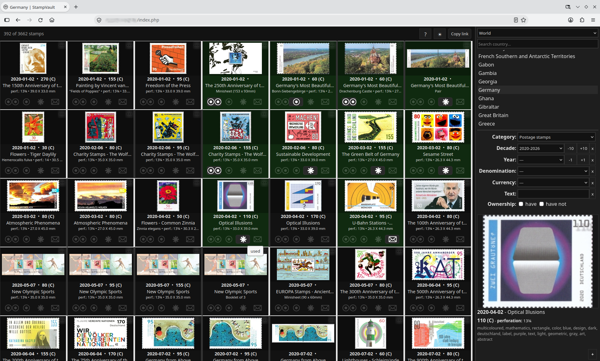
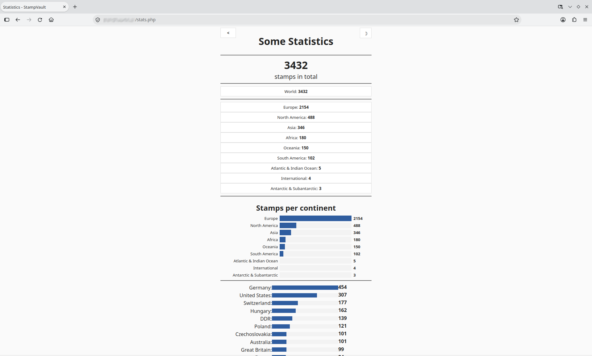
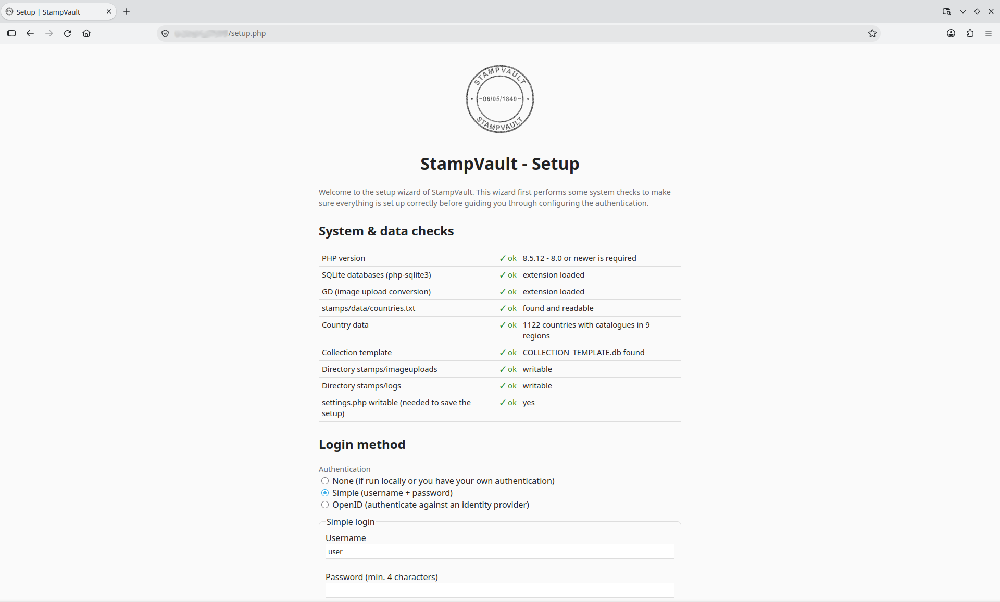

# StampVault



A self-hosted web app for cataloguing and tracking a stamp collection.

Plain PHP + SQLite + vanilla JavaScript - no build step, no database server, no framework. Drop it on any PHP host and open it in a browser.

## Features

- **Catalogue browsing** per world region and country, with natural-sorted stamp lists, grouping, and filters for category, year, denomination and currency
- Almost **one million** stamp entries available, most with associated stamp image
- **Ownership tracking**: four states per stamp (mint / unused / used / first day cover) plus free-text notes
- **Custom images**: upload or drag &amp; drop your own scan for any stamp - non-JPEG files are converted automatically (needs PHP GD)
- **Statistics**: owned-stamp counts per continent and per country with bar charts
- **Dark mode**, keyboard shortcuts, shareable URLs, and a read-only mode (`?read=only`) for showing the collection without allowing changes
- **Setup wizard**: on first open it checks the environment and data, then lets you pick the login method and set a password - afterwards it doubles as a self-test page (log in and navigate to `setup.php`)
- Three authentication modes: none, username + password (bcrypt), or OpenID Connect

## Screenshots

<div align="center">
    <a href="screenshots/welcome-screen.png"></a>
    <a href="screenshots/mainscreen.png"></a>
</div>
<div align="center">
    <a href="screenshots/detailedview.png"></a>
    <a href="screenshots/mainscreen-darkmode.png"></a>
</div>
<div align="center">
    <a href="screenshots/statistics.png"></a>
    <a href="screenshots/setup-wizard.png"></a>
</div>

## Requirements

- PHP **8.0+** with the `php-sqlite3` extension
- `php-gd` (optional - without it only ready-made JPEGs can be uploaded)
- A web server with PHP support, or PHP's built-in server for local testing: `php -S localhost:8000`
- `composer` **if** you use OpenID authentication (requires running `composer require jumbojett/openid-connect-php` inside the `assets/` folder)

## Getting started

```bash
# clone the app (see below for how to pull only part of the data)
git clone https://github.com/StampVault/StampVault
cd StampVault
git submodule update --init    # fetch the stamp data repositories - warning: a lot of data!

# local test
cd app/
php -S localhost:8000
```

To serve StampVault with a web server (nginx, apache, ...) simply set the root folder to the `app/` subdirectory of the cloned repository.

Then open the app in a browser. On the first run it redirects to the **setup wizard**, which:

1. runs environment and data checks (PHP version, SQLite, `countries.txt`, catalogue databases, writable directories) and points you to this README if data is missing,
2. lets you choose the login method - none, username + password, or OpenID,
3. writes your choices to `settings.php` and forwards you to the login page.

The wizard needs write permission on `settings.php`! If it does not have it, it prints the generated configuration for copy &amp; paste instead.

## The data and git submodules

The stamp data is far too large to keep in this repository. It lives in several git repositories, one per world region, which are added as **submodules** under `stamps/data/`:

```
StampVault/app/
├── index.php, login.php, stats.php, setup.php, settings.php
├── assets/                 # PHP endpoints, JS, CSS
└── stamps/
    ├── data/
    │   ├── countries.txt   # country list + continent headers (small)
    │   ├── Europe/         # git submodule
    │   ├── Africa1/        # git submodule - countries A–L
    │   ├── Africa2/        # git submodule - countries M–Z
    │   └── ...
    ├── collection/         # YOUR ownership data - never in git
    ├── imageuploads/       # YOUR uploaded scans - never in git
    └── logs/               # transparency logs of all changes - never in git
```

The submodules are listed in the git configuration, running `git submodule update --init` will put all the data into the right subdirectories automatically.

### Working with only part of the data

All the data requires around 33 GB of available space plus around 16 GB for the `.git` folder. It is very easy to only work with *part* of the data, depending on your needs. The easiest way to restrict the local data is by only checking out the world regions that you are interested in:

```bash
git clone https://github.com/StampVault/StampVault
cd StampVault

git submodule update --init "app/stamps/data/Europe"   # just one region
# or a few at a time:
git submodule update --init "app/stamps/data/Africa1" "app/stamps/data/Africa2"
```

There are a total of 10 submodules that can be requested locally:

| world region              | submodule folder                        | approximate sizes   | git repository                                      |
| ------------------------- | --------------------------------------- | ------------------- | --------------------------------------------------- |
| Africa (part 1)           | `app/stamps/data/Africa1`               | 6.2 GB              | https://github.com/StampVault/Africa1               |
| Africa (part 2)           | `app/stamps/data/Africa2`               | 6.4 GB              | https://github.com/StampVault/Africa2               |
| Antarctic & Subantarctic  | `app/stamps/data/AntarcticSubantarctic` | 0.2 GB              | https://github.com/StampVault/AntarcticSubantarctic |
| Asia                      | `app/stamps/data/Asia`                  | 6.1 GB              | https://github.com/StampVault/Asia                  |
| Atlantic & Indian Ocean   | `app/stamps/data/AtlanticIndianOcean`   | 0.3 GB              | https://github.com/StampVault/AtlanticIndianOcean   |
| Europe                    | `app/stamps/data/Europe`                | 5.0 GB              | https://github.com/StampVault/Europe                |
| International             | `app/stamps/data/International`         | 0.3 GB              | https://github.com/StampVault/International         |
| North America             | `app/stamps/data/NorthAmerica`          | 4.5 GB              | https://github.com/StampVault/NorthAmerica          |
| Oceania                   | `app/stamps/data/Oceania`               | 2.7 GB              | https://github.com/StampVault/Oceania               |
| South America             | `app/stamps/data/SouthAmerica`          | 1.9 GB              | https://github.com/StampVault/SouthAmerica          |

*Notes on partial data:*

- **The country list always comes from `countries.txt`** (a few KB) - every country is listed and searchable even if its data is not checked out.
- Countries without local data simply report *database not found* when opened the setup wizard's self-test lists exactly which catalogues are missing (`setup.php`, re-runnable any time).
- Prefer shallow clones to keep it light:
  ```bash
  git clone --recurse-submodules --shallow-submodules --depth 1 https://github.com/StampVault/StampVault
  ```

  or, with recent git, a blobless clone and fetch data on demand:
  ```bash
  git clone --filter=blob:none https://github.com/StampVault/StampVault
  git submodule update --init --depth 1 "app/stamps/data/Europe"
  ```
- To free up disk space again:
  ```bash
  git submodule deinit "app/stamps/data/Europe"
  ```

  Re-run `git submodule update --init <path>` later to bring it back.
- To keep the interface tidy, the setup wizard drafts a `$whitelist_countrylist` containing exactly the countries with local data. Tick the corresponding checkbox during first-run setup and the country list shows only what is actually present. The inverse, `$blacklist_countrylist`, with the missing countries works too, but it is only evaluated when the whitelist is empty.
- `git submodule update --init` after pulling the main repository to get the submodule commits it points at. Add `--remote` to track the data repositories' branches.

### Data format

- `countries.txt` - one country per line: `Display Name[|alias]|sanitized` (display name, optional search alias, sanitized folder/file name), grouped under `# <Continent>` headers, with `---` separating main countries from territories.
- **Catalogue databases**: `stamps/data/<Region>/<Country>/data.db` (SQLite; per-country stamps, natural-sorted by `sortid`)
- **Stamp images**: `stamps/data/<Region>/<Country>/images/<xy>/<id>.jpg` - sharded into subfolders by the first two characters of the stamp id to keep directory sizes manageable
- **Your collection**: `stamps/collection/<Country>.db` (created on first write from `COLLECTION_TEMPLATE.db`) and your uploaded scans in `stamps/imageuploads/<Country>/<xy>/` - both are personal data and should stay out of git.

## Configuration

All configuration lives in `settings.php`:

| setting                                             | used for                                            |
| --------------------------------------------------- | --------------------------------------------------  |
| `$type_of_auth`                                     | `none`, `simple` or `openid`                        |
| `$simple_username` / `$simple_password_hash`        | login for `simple` mode (bcrypt hash only)          |
| `$allow_select_continent`                           | hide the continent selector and show all countries  |
| `$whitelist_countrylist` / `$blacklist_countrylist` | show only / all except these countries              |
| `$default_countries`                                | default country per continent                       |
| `$documentation_url`                                | where the setup wizard points when data is missing  |
| `$setup_completed`                                  | `false` -> every page redirects to the setup wizard |

### Enabling the one-time password

The simple login can require a 6-digit one-time code (TOTP, RFC 6238) in addition to the password - any authenticator app works (Aegis, Google Authenticator, 1Password, etc.).

To use this additional security, follow these steps:

1. Generate a random 32-character base32 secret and copy it into `$simple_otp_secret` in `settings.php`. There are different ways to generate such a random string, choose whichever method works best for you:
- `OpenSSL`:
```bash
openssl rand -hex 20 | xxd -r -p | base32
```
- `PHP`:
```bash
php -r '$A="ABCDEFGHIJKLMNOPQRSTUVWXYZ234567";$d=random_bytes(20);$o="";for($i=0;$i<20;$i+=5){$b="";for($j=0;$j<5;$j++)$b.=sprintf("%08b",ord($d[$i+$j]));for($k=0;$k<8;$k++)$o.=$A[bindec(substr($b,$k*5,5))];}echo $o."\n";'
```
2. Add the same key to your authenticator app - choose the *manual entry* / *enter a setup key* option (6 digits, 30-second period).
3. Log out and back in: the form now also asks for the one-time code, and a used code cannot be replayed within its validity window.

Failed logins are counted per IP and per account: every failure delays the reply by 1–5 seconds, and after 5 failures within 10 minutes the login is locked for 15 minutes - doubling with every further failure. A successful login resets the counters. The error message is identical for a wrong password and a wrong one-time code, so a failed attempt never reveals which factor was wrong.

## Security notes

- Write endpoints require a session and a CSRF token; sessions use HttpOnly, SameSite=Lax cookies (Secure on HTTPS)
- Passwords are stored as bcrypt hashes (`password_hash()`), verified timing-safely
- Country names are validated against `countries.txt` before any filesystem access (blocks path traversal); uploads are verified by content and re-encoded to JPEG
- All dynamic output is escaped

## FAQ

**Where is the data coming from?**  
The data is sourced from a variety of freely-accessible sources online.

**Will the data be updated?**  
There is no guarantee or promise about any data updates. A best effort attempt will be done to update the data every now and then. If you have any missing data, please feel free to open pull requests in the data repositories with your updates.

**Who are you?**  
I'm just someone who collects stamps and over time has built up this web application to help me manage my own collection. By now it is pretty polished and works quite well, and I thought others might benefit from it to.

**Can I support you?**  
Well, you can't support this project directly, other than by contributing data. But if you want to show your appreciation with a donation, there are a few open source projects I'm a heavy user and a big fan of that you can support instead:

- KDE: https://kde.org
- PhotoQt: https://photoqt.org
- JellyFin: https://jellyfin.org/


## License

All the data is licensed under the [Creative Commons Attribution 4.0](https://creativecommons.org/licenses/by/4.0/legalcode). The web application is licensed under the [GPL-3](https://www.gnu.org/licenses/gpl-3.0.html#license-text).
